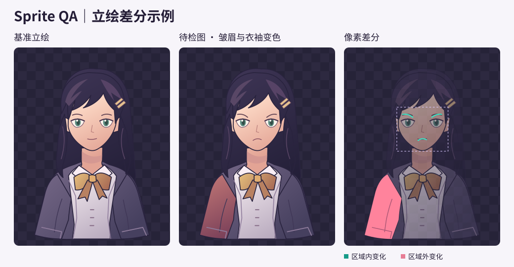

# Sprite QA · 立绘差分验收

Sprite QA 是一个离线工具，用来验收视觉小说的同姿势立绘差分。选一张基准立绘，框出允许改动的脸部，再批量检查其他像素。衣袖变色、轮廓偏移、画布尺寸不符和丢失透明背景，都能在导入引擎前复核。



## 快速开始

1. 下载或解压项目，在桌面浏览器中双击根目录的 `index.html`。使用当前版本的 Chrome 或 Edge 即可。浏览器打开页面后即可使用，无需联网、安装依赖或启动服务器。
2. 点 **加载演示** 试用。演示中有一张基准和五张待检图，涵盖纯表情改动、衣袖变色、整体偏移、尺寸不符和不透明底。
3. 点 **导入素材** 或把文件拖入页面。每批同时导入基准和待检图。页面默认选取第一张有效的立绘，可从 **基准立绘** 下拉框切换。重新导入会替换当前批次。
4. 点 **框选**，在预览中拖出允许变化的矩形，或填写像素坐标后点 **应用坐标**。矩形为空时，整张图都计入区域外。建议把有意改动的动作拆成各自的批次，为每个姿势单独选择基准。
5. 点击结果里的文件名。用 **差分** 查变化位置，或用 **分屏** 拖动分界线对照原图。用 **仅待处理** 筛选异常和超限项。**导出 JSON** 会保存全批次的结果、阈值及坐标，方便复核。

支持静态 PNG 和 WebP。每批最多 100 张，单张不超过 64 MiB，画布单边不超过 8192 像素且总面积不超过 16,777,216 像素。素材由浏览器直接读取，输入文件保持原样。

## 比较规则

| 规则 | 定义 |
| --- | --- |
| 坐标 | 以基准画布左上角为原点，用 `x, y, width, height` 指定矩形。右边与下边为开区间。 |
| 可比像素 | 两张图至少一张在该坐标的 Alpha 大于 0。两张图都完全透明的位置跳过。 |
| 像素变化 | 在浏览器解码后的 RGBA 中，Alpha 差值或任一预乘颜色通道的差值严格大于像素差阈值。默认阈值为 12 / 255。 |
| 变化率 | 每个区域分别用其变化像素数除以可比像素数。区域外变化率超过默认的 0.25% 时标为复核。没有区域外可比像素时也标为复核。 |
| 文件异常 | 动画、格式不符、解码失败、画布尺寸不符、全图透明或全图不透明的文件都会标出。 |

比较基于原始画布坐标，无自动对齐。画布整体偏移也会计入差分。有损 WebP 可能产生压缩差异，可按素材调整阈值。表格里的百分比为显示精度，报告同时保留比较像素数和变化像素数。

## 开发

构建和测试需要 Node.js 22 或以上，无需安装 npm 依赖。

```sh
npm run build
npm test
npm run check
```

在 `src/` 修改源码后运行构建，再打开根目录的 `index.html`。构建把源码内联进单个 HTML，便于离线分发。`npm run check` 会验证根目录的 HTML 与源码一致。

JSON 报告的 `schemaVersion` 为 `1`。文件状态为 `reference`、`pass`、`review`、`error` 或 `pending`。`comparison` 在无法比较时为 `null`。可比像素数为零时，相应的 `percent` 为 `null`。
